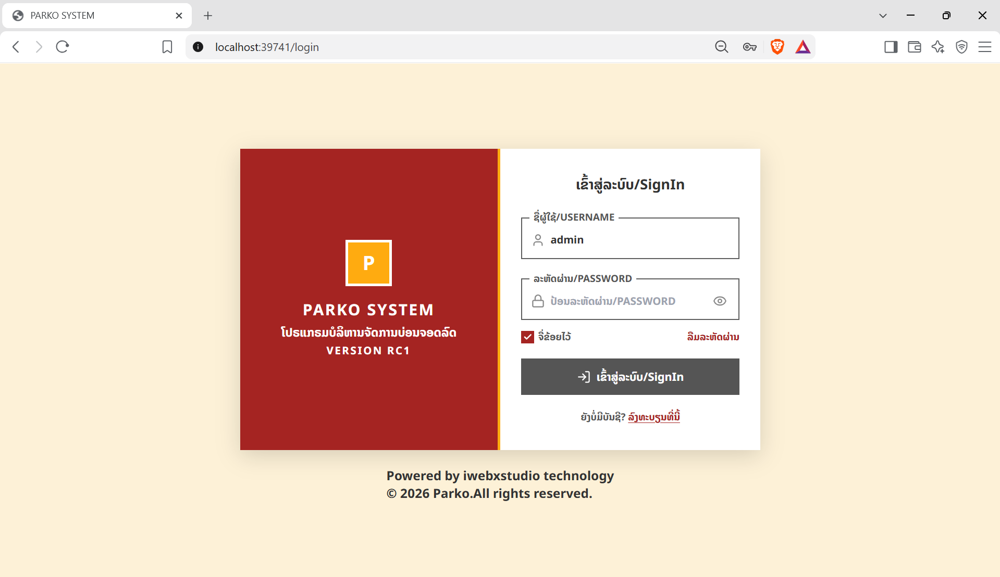
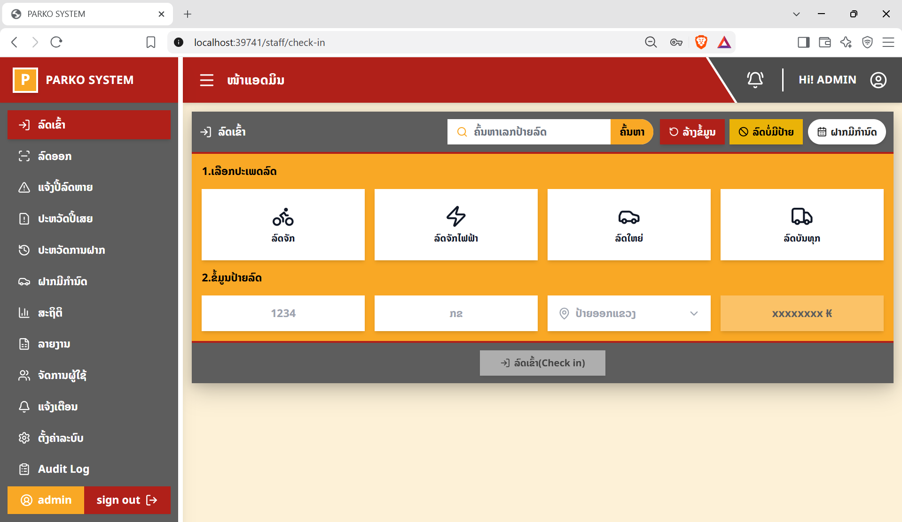

# 🚗 PARKO — ໂປຣແກຣມບໍລິຫານຈັດການບ່ອນຈອດລົດ

> **Smart Parking Management System**  
> ໂປຣແກຣມລະບົບຄຸ້ມຄອງບໍລິຫານບ່ອນຈອດລົດ ຮອງຮັບລົດທຸກປະເພດ ທັງລົດມີປ້າຍ ແລະ ບໍ່ມີປ້າຍ. ໃຊ້ງານໄດ້ຜ່ານໂທລະສັບ, ຄອມພິວເຕີ ແລະ ແທັບເລັດ. ສາມາດພິມປີ້/ໃບຮັບເງິນຜ່ານ Thermal Printer (USB/Bluetooth), ຮອງຮັບການສະແກນ QR Code, ຄິດໄລ່ຄ່າຈອດ Real-time, ພິມປີ້ຄວາມຮ້ອນ ESC/POS ແລະ ຈັດການປີ້ເສຍ. ລະບົບເນັ້ນ High-Performance, Enterprise Security, Clean code, ລະບົບນິ່ງຄວາມສະຖຽນ ແລະ ຮອງຮັບການອັບເກຣດລະບົບໄດ້ໃນອະນາຄົດ.

[](https://nestjs.com/)
[](https://react.dev/)
[](https://www.postgresql.org/)
[](https://www.prisma.io/)
[](https://www.docker.com/)

---

### 📸 ພາບຕົວຢ່າງໜ້າຕາລະບົບ (Application Screenshots)

| 🔐 ໜ້າຈໍເຂົ້າສູ່ລະບົບ (Login Portal) | 🚗 ໜ້າຈໍ Check-in ລົດເຂົ້າ (Staff Dashboard) |
| :---: | :---: |
|  |  |

---

## 1. ພາບລວມໂຄງການ (Project Overview)

PARKO ໂປຣແກຣມລະບົບຄຸ້ມຄອງບໍລິຫານບ່ອນຈອດລົດ ຮອງຮັບລົດທຸກປະເພດ ທັງລົດມີປ້າຍ ແລະ ບໍ່ມີປ້າຍ. ໃຊ້ງານໄດ້ຜ່ານໂທລະສັບ ແລະ ຄອມພິວເຕີ ແທັບເລັດ ສາມາດພິມປີ້/ໃບຮັບເງິນຜ່ານ Thermal Printer (USB/Bluetooth), ຮອງຮັບການສະແກນ QR Code, ຄິດໄລ່ຄ່າຈອດ Real-time, ພິມປີ້ຄວາມຮ້ອນ ESC/POS ແລະ ຈັດການປີ້ເສຍ. ລະບົບເນັ້ນ High-Performance, Enterprise Security, Clean code, ລະບົບນິ່ງຄວາມສະຖຽນ ແລະ ຮອງຮັບການອັບເກຣດລະບົບໄດ້ໃນອະນາຄົດ.

### ຈຸດປະສົງ ແລະ ບັນຫາທີ່ລະບົບແກ້ໄຂ

- **ລົບລ້າງລະບົບເຈ້ຍແບບດັ້ງເດີມ:** ແກ້ໄຂບັນຫາການຈົດປີ້ເຈ້ຍດ້ວຍມືທີ່ຊັກຊ້າ, ເກີດຂໍ້ຜິດພາດງ່າຍ, ແລະ ບໍ່ສາມາດກວດສອບຍ້ອນຫຼັງໄດ້.
- **ປ້ອງກັນການຮົ່ວໄຫຼຂອງລາຍຮັບ:** ລະບົບຄຳນວນຄ່າຈອດລົດແບບອັດຕະໂນມັດຕາມເວລາຈິງ (Real-time LAK) ພ້ອມບັນທຶກປະຫວັດການເງິນ.
- **ຮອງຮັບຍານພາຫະນະທຸກຮູບແບບ:** ຈັດການໄດ້ທັງລົດໃຫຍ່, ລົດຈັກ, ລົດໄຟຟ້າ (EV), ລົດບັນທຸກ, ທັງລົດທີ່ມີປ້າຍທະບຽນ, ບໍ່ມີປ້າຍ ຫຼື ປ້າຍຕ່າງປະເທດ ດ້ວຍລະຫັດປີ້ QR Code ເອກະລັກ.
- **ຈັດການກໍລະນີປີ້ເສຍ (Lost Ticket) ຢ່າງຮັດກຸມ:** ມີຂັ້ນຕອນບັນທຶກຫຼັກຖານຮູບພາບຜູ້ຂັບຂີ່, ຕົວລົດ ແລະ ເອກະສານຢືນຢັນຕົວຕົນ ພ້ອມລະບົບອະນຸມັດໂດຍ Admin.

---

## 2. ຄວາມສາມາດຫຼັກຂອງລະບົບ (Features)

| ໂມດູນຫຼັກ | ລາຍລະອຽດການເຮັດວຽກ |
| :--- | :--- |
| **Check-in (ລົດເຂົ້າ)** | ບັນທຶກລົດເຂົ້າພາຍໃນ 2 ຄລິກ (< 2 ວິນາທີ), ສ້າງ Ticket ID ພ້ອມ QR Code, ບັນທຶກເວລາເຂົ້າ, ປະເພດລົດ, ປ້າຍທະບຽນ ແລະ ສັ່ງພິມປີ້ເຂົ້າອັດຕະໂນມັດ |
| **Check-out (ລົດອອກ)** | ສະແກນ QR Code, ຄົ້ນຫາຕາມເລກປີ້ ຫຼື ປ້າຍທະບຽນ; ຄິດໄລ່ໄລຍະເວລາຈອດ ແລະ ຄ່າບໍລິການອັດຕະໂນມັດ ປ້ອງກັນລົດອອກໂດຍບໍ່ໄດ້ຮັບອະນຸຍາດ |
| **ຄິດໄລ່ຄ່າຈອດ (Fee Engine)** | ຮອງຮັບຊ່ວງເວລາຈອດຟຣີ (Grace Period), ອັດຕາຄິດໄລ່ລາຍຊົ່ວໂມງ, ເໝົາລາຍວັນ, ລາຍອາທິດ, ລາຍເດືອນ, ລາຍປີ ແລະ ລະບົບສະມາຊິກ (Membership) ແຍກຕາມປະເພດລົດ |
| **ຊຳລະເງິນ (Payments)** | ຮອງຮັບທັງເງິນສົດ (Cash) ແລະ ສະແກນ QR Code (Static/Dynamic QR); ບັນທຶກສະຖານະ `UNPAID`, `PAID`, `CANCELLED` ພ້ອມພິມໃບຮັບເງິນ |
| **ປີ້ເສຍ (Lost Ticket)** | ແຈ້ງປີ້ເສຍພ້ອມອັບໂຫຼດຮູບຫຼັກຖານ (ຮູບລົດ, ຮູບຜູ້ຂັບຂີ່, ບັດປະຈຳຕົວ), ຄິດໄລ່ຄ່າປັບໃໝ ແລະ ລໍຖ້າການອະນຸມັດຈາກ Admin ພ້ອມ Audit Log |
| **Dashboard & ສະຖິຕິ** | ສະແດງຈຳນວນລົດເຂົ້າ-ອອກ, ອັດຕາບ່ອນຈອດຫວ່າງ/ເຕັມ, ແລະ ລາຍຮັບລວມແບບ Real-time ຜ່ານ WebSocket |
| **ລາຍງານ (Reports & Export)** | ສະຫຼຸບລາຍງານລາຍຮັບ, ປະຫວັດທຸລະກຳ, ປີ້ເສຍ ພ້ອມ Export ເປັນໄຟລ໌ Excel (.xlsx) ແລະ PDF |
| **ສິດການໃຊ້ງານ (RBAC)** | ແບ່ງສິດລະຫວ່າງ **ADMIN** (ຈັດການຜູ້ໃຊ້, ຕັ້ງລາຄາ, ອະນຸມັດປີ້ເສຍ, ລາຍງານ) ແລະ **STAFF** (Check-in, Check-out, ຮັບເງິນ) |

---

## 3. ເຕັກໂນໂລຊີທີ່ນຳໃຊ້ (Tech Stack)

### 3.1 Frontend

- **Framework & Core:** [React 19](https://react.dev/) (`19.2.5`), [TypeScript](https://www.typescriptlang.org/) (`~6.0.2`)
- **Build Tool:** [Vite 8](https://vitejs.dev/) (`8.0.10`) ສຳລັບ Lightning-fast Bundling & HMR
- **Styling:** [Tailwind CSS v3](https://tailwindcss.com/) (`3.4.19`), PostCSS, Lucide React Icons
- **Realtime & Client:** Socket.io-client (`4.8.3`), Axios (`1.15.2`), React Router DOM v7
- **Data & Charts:** Chart.js (`4.5.1`), XLSX (`0.18.5`), Html5-qrcode (`2.3.8`), JsBarcode

### 3.2 Backend

- **Framework:** [NestJS 11](https://nestjs.com/) (`11.0.1`) ໂຄງສ້າງ Clean Architecture
- **Language & Runtime:** [Node.js 20+](https://nodejs.org/) (LTS), TypeScript (`5.7.3`)
- **ORM:** [Prisma ORM 6](https://www.prisma.io/) (`6.4.1`)
- **Security & Auth:** Passport JWT, BcryptJS, Helmet (`8.1.0`), Class-Validator, Express Rate Limit
- **Realtime & Media:** Socket.io Gateway, Multer, Sharp (Image Processing)
- **Document & Print:** PDFMake, ExcelJS, ESC/POS Network/USB Thermal Agent

### 3.3 Infrastructure & Database

- **Database:** [PostgreSQL 16](https://www.postgresql.org/) (Alpine-based, Tuned Buffers & Cache)
- **Cache & Rate Limit:** [Redis 7](https://redis.io/) (Alpine, LRU Eviction Policy)
- **Gateway & Web Server:** [Nginx](https://nginx.org/) (Reverse Proxy, SSL/TLS Termination, Gzip, Rate Limiting)
- **Containerization:** [Docker Engine](https://www.docker.com/) & Docker Compose v2

---

## 4. ໂຄງສ້າງໂຟນເດີ (Project Structure)

```text
PARKO/
├── backend/                  # NestJS REST API Server & WebSocket Gateway
│   ├── prisma/               # Prisma Database Schema, Migrations, Seed script
│   └── src/
│       ├── common/           # Decorators, Filters, Guards, Interceptors, Pipes
│       ├── core/             # Database connection, Redis client, App configuration
│       └── modules/          # Auth, Users, Parking, Payments, LostTickets, Reports...
├── docs/                     # ເອກະສານ ແລະ ຮູບພາບ Screenshots ສຳລັບ README
│   └── screenshots/          # ຮູບພາບຕົວຢ່າງໜ້າຕາລະບົບ (Cover, Login, CheckIn)
├── frontend/                 # React 19 Single Page Application (SPA)
│   └── src/
│       ├── components/       # Reusable UI components (Modals, Badges, Tables)
│       ├── pages/            # ຫນ້າຫຼັກ: Staff Portal (CheckIn, CheckOut) & Admin Dashboard
│       ├── services/         # Axios API clients, Socket.io connection, Print services
│       └── types/            # TypeScript interfaces ແລະ Type definitions
├── infra/                    # ໂຄງສ້າງພື້ນຖານ (Infrastructure)
│   ├── database/backup/      # ບ່ອນຈັດເກັບໄຟລ໌ Database Backup (.sql)
│   └── nginx/                # ໄຟລ໌ຕັ້ງຄ່າ Nginx Reverse Proxy (nginx.conf) ແລະ SSL Certs
├── scripts/                  # ສະຄຣິບ Backup ແລະ Restore ຖານຂໍ້ມູນ (.sh / .ps1)
├── services/print-agent/     # Node.js Agent ສຳລັບເຊື່ອມຕໍ່ເຄື່ອງພິມ ESC/POS Thermal Printer
├── docker-compose.yml        # Docker Multi-container Production Orchestration
├── docker-compose.dev.yml    # Docker Development Dependencies (PostgreSQL + Redis)
├── deploy.ps1 / deploy.sh    # ສະຄຣິບ One-click Build & Deploy ອັດຕະໂນມັດ
└── .env.example              # ແມ່ແບບການຕັ້ງຄ່າຕົວປ່ຽນສະພາບແວດລ້ອມ (Environment Variables)
```

---

## 5. ສິ່ງທີ່ຕ້ອງມີ ແລະ ວິທີຕິດຕັ້ງ (Prerequisites & Installation)

### 5.1 ສິ່ງທີ່ຕ້ອງມີກ່ອນຕິດຕັ້ງ (Prerequisites)

- **Docker:** Docker Engine 20.10+ ແລະ Docker Compose v2.0+ ຂຶ້ນໄປ
- **OS Support:** Windows 10/11 (WSL2), Ubuntu/Debian Linux, ຫຼື macOS
- **System Spec:** CPU 2 Cores ຂຶ້ນໄປ, RAM ຢ່າງໜ້ອຍ 4 GB (ແນະນຳ 8 GB ສຳລັບ Production), ພື້ນທີ່ຫວ່າງ 10 GB
- _(ສຳລັບ Local Dev ແບບບໍ່ໃຊ້ Docker)_: Node.js >= 20.0.0, npm >= 10.0.0, PostgreSQL 16, Redis 7

### 5.2 ຂັ້ນຕອນການຕິດຕັ້ງ (Step-by-Step Installation)

#### ຂັ້ນຕອນທີ 1: Clone Repository

```bash
git clone https://github.com/your-org/parko.git
cd parko
```

#### ຂັ້ນຕອນທີ 2: ເປີດໃຊ້ງານລະບົບໄດ້ທັນທີ (Turnkey Launch)

ລະບົບມີການກຳນົດຄ່າເລີ່ມຕົ້ນ (`.env`) ພ້ອມໃຊ້ງານມາໃຫ້ແລ້ວ ທ່ານພຽງແຕ່ເປີດ **Docker Desktop** ແລ້ວໃຊ້ຄຳສັ່ງດຽວ:

```bash
docker-compose up -d
```

*(ຫຼື `docker compose up -d`)*

> 💡 **ສຳລັບ Windows (ງ່າຍທີ່ສຸດ):** ສາມາດດັບເບິ້ລຄລິກໄຟລ໌ `start.bat` ເພື່ອເປີດລະບົບ ແລະ ເປີດ Browser ຂຶ້ນມາອັດຕະໂນມັດໄດ້ເລີຍ!

---

## 6. ວິທີເຂົ້າໃຊ້ງານ (Usage)

### 6.1 URLs ສຳລັບເຂົ້າເຖິງລະບົບ

| ບໍລິການ | ໂປຣໂຕຄໍ / URL | ລາຍລະອຽດ |
| :--- | :--- | :--- |
| **Frontend UI (Staff & Admin)** | `http://localhost:39741` | ລະບົບໜ້າຈໍຫຼັກ (HTTP Gateway) |
| **Frontend UI (Secure HTTPS)** | `https://localhost:39742` | ເຂົ້າລະຫັດ SSL/TLS (ແນະນຳສຳລັບກ້ອງສະແກນ QR) |
| **Backend REST API** | `http://localhost:39741/api` | API Endpoints ຜ່ານ Nginx Reverse Proxy |
| **Swagger API Docs** | `http://localhost:39741/api/docs` | ເອກະສານ OpenAPI / Swagger Interactive Testing |
| **System Health Check** | `http://localhost:39741/health` | ຈຸດກວດສອບສະຖານະຄວາມພ້ອມຂອງລະບົບ |

### 6.2 ຄຳສັ່ງກວດສອບ ແລະ ຈັດການລະບົບ (Management Commands)

- **ກວດສອບສະຖານະ Containers ທັງໝົດ:**

  ```bash
  docker compose ps
  ```

- **ເບິ່ງ Log ການເຮັດວຽກຂອງລະບົບ (Real-time Logs):**

  ```bash
  # ເບິ່ງ Log ທຸກໆ Services
  docker compose logs -f

  # ເບິ່ງ Log ສະເພາະ Backend API
  docker compose logs -f backend

  # ເບິ່ງ Log ສະເພາະ PostgreSQL Database
  docker compose logs -f postgres
  ```

- **ຢຸດການເຮັດວຽກຂອງລະບົບ (Stop):**

  ```bash
  docker compose down
  ```

- **Restart ທຸກ Service ໃໝ່:**

  ```bash
  docker compose restart
  ```

---

## 7. ຄວາມປອດໄພ (Security)

### 7.1 ການຈັດການ Secrets & `.env`

- ຫ້າມ Commit ຟາຍ `.env` ທີ່ມີຂໍ້ມູນລະຫັດຜ່ານຕົວຈິງຂຶ້ນ Git Repository ຢ່າງເດັດຂາດ (ຖືກກັນໄວ້ໃນ `.gitignore`).
- ປ່ຽນຄ່າ `JWT_SECRET` ໃນ `.env` ໃຫ້ເປັນລະຫັດສຸ່ມທີ່ມີຄວາມຍາວຢ່າງໜ້ອຍ 32 ຕົວອັກສອນ.
- ປ່ຽນຄ່າ `POSTGRES_PASSWORD` ຈາກຄ່າເລີ່ມຕົ້ນກ່ອນນຳໃຊ້ໃນ Production.

### 7.2 ບັນຊີເລີ່ມຕົ້ນ (Default Accounts)

ເມື່ອລະບົບທຳການ Seed Data ຈະສ້າງບັນຊີທົດສອບດັ່ງນີ້:

| ບົດບາດ (Role) | ຊື່ຜູ້ໃຊ້ (Username) | ລະຫັດຜ່ານ (Password) |
| :--- | :--- | :--- |
| **Admin** | `admin` | `admin123` |
| **Staff** | `staff01` | `staff123` |

> ⚠️ **ຂໍ້ຄວນລະວັງ:** ຫຼັງຈາກຕິດຕັ້ງລະບົບສຳເລັດ ຕ້ອງເຂົ້າໄປປ່ຽນລະຫັດຜ່ານຂອງທຸກ User ເລີ່ມຕົ້ນທັນທີ!

### 7.3 ຂໍ້ຄວນລະວັງດ້ານ Production

- **SSL/TLS Certificates:** ລະບົບເລີ່ມຕົ້ນໃຊ້ Self-Signed Certificate ເຊິ່ງ Browser ຈະແຈ້ງເຕືອນ Untrusted. ສຳລັບ Production ຕົວຈິງ ຕ້ອງປ່ຽນໄປໃຊ້ໃບຢັ້ງຢືນທີ່ຖືກຕ້ອງ (ເຊັ່ນ Let's Encrypt / CA) ໂດຍວາງໄວ້ທີ່ `infra/nginx/certs/`.
- **CORS & Network Firewall:** ກຳນົດ `CORS_ORIGIN` ໃນ `.env` ໃຫ້ອະນຸຍາດສະເພາະ Domain ທີ່ຕ້ອງການ. ບໍ່ຄວນເປີດ Public Port ຂອງ PostgreSQL (`39744`) ແລະ Redis (`39745`) ສູ່ພາຍນອກ.

---

## 8. ຖານຂໍ້ມູນ ແລະ ການສຳຮອງຂໍ້ມູນ (Database & Backup)

### 8.1 Database Migration & Seed (ສຳລັບ Development)

ຫາກຕ້ອງການພັດທະນາເພີ່ມເຕີມໃນຝັ່ງ Backend ສາມາດສັ່ງຄຳສັ່ງ Prisma ໄດ້ດັ່ງນີ້:

```bash
cd backend

# ສ້າງ ແລະ Run Migration ໃໝ່
npx prisma migrate dev --name <migration_name>

# Generate Prisma Client
npx prisma generate

# ລົງຂໍ້ມູນເລີ່ມຕົ້ນ (Seed Default Data: Admin, Staff, Rates)
npm run prisma:seed

# ເປີດ Web GUI ສຳລັບຈັດການຂໍ້ມູນໃນ Database
npx prisma studio
```

### 8.2 ການສຳຮອງຂໍ້ມູນ (Backup)

- **ສຳຮອງຂໍ້ມູນອັດຕະໂນມັດ (Automated Backup):** Docker Compose ມີ Service `backup` ທີ່ເຮັດວຽກເບື້ອງຫຼັງ ທຳການ Dump ຖານຂໍ້ມູນທຸກໆ **12 ຊົ່ວໂມງ** ໄປເກັບໄວ້ທີ່ `infra/database/backup/` ພ້ອມລຶບໄຟລ໌ເກົ່າທີ່ເກີນ 30 ວັນອັດຕະໂນມັດ.
- **ສັ່ງສຳຮອງຂໍ້ມູນດ້ວຍມື (Manual Backup):**

  ```powershell
  # Windows PowerShell
  .\scripts\backup.ps1
  ```

  ```bash
  # Linux / macOS
  chmod +x scripts/backup.sh
  ./scripts/backup.sh
  ```

### 8.3 ການກູ້ຄືນຂໍ້ມູນ (Restore)

ຫາກຕ້ອງການ Restore ຖານຂໍ້ມູນຈາກໄຟລ໌ Backup (`.sql`):

```powershell
# Windows PowerShell
.\scripts\restore.ps1 -BackupFile "infra/database/backup/backup_YYYYMMDD_HHMMSS.sql"
```

```bash
# Linux / macOS (ຫາກບໍ່ລະບຸໄຟລ໌ ລະບົບຈະເລືອກໄຟລ໌ລ່າສຸດໃຫ້ອັດຕະໂນມັດ)
chmod +x scripts/restore.sh
./scripts/restore.sh infra/database/backup/backup_YYYYMMDD_HHMMSS.sql
```

---

## 9. ການແກ້ໄຂບັນຫາເບື້ອງຕົ້ນ (Troubleshooting)

| ບັນຫາທີ່ພົບເລື້ອຍ | ສາເຫດທີ່ອາດເກີດຂຶ້ນ | ວິທີແກ້ໄຂ |
| :--- | :--- | :--- |
| **Port ซ້ຳກັນ (Port Conflict)** | ພອດທີ່ລະບົບໃຊ້ (ເຊັ່ນ 39741, 39744) ຖືກໂປຣແກຣມອື່ນໃນ Host ຈອງຢູ່ແລ້ວ | ແກ້ໄຂເລກພອດໃນ `.env` (ເຊັ່ນ ປ່ຽນ `PARKO_PORT=39841`) ແລ້ວ Restart ລະບົບ |
| **Container ບໍ່ Start / Unhealthy** | Build Cache ເກົ່າຄ້າງ ຫຼື ເກີດຂໍ້ຜິດພາດຂະນະ Start Service | ໃຊ້ຄຳສັ່ງ `docker compose logs <service>` ເພື່ອກວດສອບ ແລະ ສັ່ງ Rebuild ໃໝ່: `docker compose down && docker compose up -d --build` |
| **Database ເຊື່ອມຕໍ່ບໍ່ໄດ້** | Service `postgres` ຍັງບໍ່ພ້ອມ ຫຼື Password ໃນ `.env` ບໍ່ກົງກັນ | ກວດສອບສະຖານະດ້ວຍ `docker compose ps` ຮັບປະກັນວ່າ `parko-postgres` ຂຶ້ນ `healthy`; ກວດສອບ `DATABASE_URL` ແລະ `POSTGRES_PASSWORD` ໃນ `.env` |
| **ກ້ອງສະແກນ QR ບໍ່ເຮັດວຽກ** | Browser ບໍ່ອະນຸຍາດໃຫ້ເປີດກ້ອງເທິງ HTTP ທຳມະດາ | ເຂົ້າໃຊ້ງານຜ່ານ HTTPS (`https://localhost:39742`) ແລະ ກົດອະນຸຍາດສິດເຂົ້າເຖິງກ້ອງ (Camera Permission) ໃນ Browser |
| **ເຄື່ອງພິມ Thermal ບໍ່ຕອບສະໜອງ** | Local Print Agent ບໍ່ສາມາດເຊື່ອມຕໍ່ USB/Port ຂອງເຄື່ອງພິມ | ກວດສອບສາຍເຊື່ອມຕໍ່ USB/Bluetooth, Driver ເຄື່ອງພິມ ແລະ ກວດສອບ Log ຂອງ `parko-print-agent` |

---
