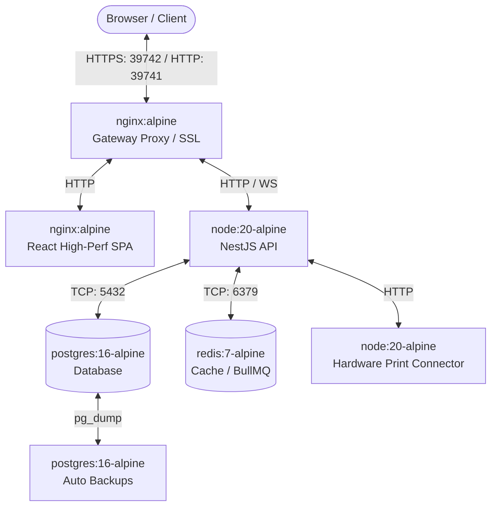

# PARKO Parking Management System — Docker Deployment Guide

This guide provides details on the production deployment architecture, security mechanisms, maintenance tasks, and monitoring configurations for the PARKO Parking Management System.

---

## 1. System Architecture

The application is orchestrated using Docker Compose into seven interconnected container services, communicating over a dedicated isolated bridge network:



---

## 2. Ports and Network Security

- **Gateway Access**: Only the `nginx` reverse proxy container binds to external ports (default: `39741` for HTTP and `39742` for HTTPS). 
- **Internal Microservices**: All other services (`backend`, `frontend`, `postgres`, `redis`, `print-agent`, `backup`) only expose ports internally within the virtual Docker network or bind exclusively to `127.0.0.1`. They are not accessible directly from outside the host machine.
- **Dynamic Port Assignment**: Mapped host ports can be customized easily by changing `PARKO_PORT` and `PARKO_SSL_PORT` in the `.env` file.

---

## 3. Production Security Features

### SSL / HTTPS Auto-Generation
The custom Nginx container (`nginx/Dockerfile` + `nginx/entrypoint.sh`) handles certificate lifecycle management:
- On startup, it checks if `server.key` or `server.crt` exists in `/etc/nginx/certs` (mounted to `./nginx/certs`).
- If missing, Nginx runs `openssl` inside the container to generate a secure, 2048-bit RSA self-signed SSL certificate valid for 10 years.
- This ensures HTTPS is immediately available without requiring any host dependencies or manual configurations.

### HTTP Security Headers
Nginx is preconfigured with standard security headers:
- `Strict-Transport-Security (HSTS)`: Forces SSL connections for 2 years (preloaded, subdomains included).
- `X-Frame-Options (SAMEORIGIN)`: Prevents clickjacking attacks.
- `X-Content-Type-Options (nosniff)`: Disables browser MIME-type sniffing.
- `X-XSS-Protection ("1; mode=block")`: Enforces XSS filtering.
- `Content-Security-Policy (CSP)`: Protects against cross-site scripting (XSS) and code injection attacks.

### SQL Injection Prevention
SQL injection is structurally prevented. The backend NestJS application queries the PostgreSQL database via **Prisma ORM**. All database queries are compiled into parameterized queries (prepared statements), making SQL injection mathematically impossible.

### Rate Limiting
- **Nginx Level**: Implements gateway-level rate limiting using `$binary_remote_addr`. The `/api/` zone allows a rate of `30 requests/sec` with a burst buffer of `20` concurrent requests.
- **Application Level**: NestJS applies a global rate limit guard via `@nestjs/throttler` restricting clients to `100 requests per 60 seconds`.

---

## 4. Automated Database Schema Setup & Seeding

1. **Automated Migrations**: The NestJS container entrypoint (`backend/docker-entrypoint.sh`) verifies database connectivity, then executes `npx prisma migrate deploy` to set up all tables and enums cleanly.
2. **Deterministic Seeding**: After migrations succeed, the entrypoint executes `node dist/prisma/seed.js` to automatically create default Admin and Staff accounts, vehicle types, and pricing rules.

---

## 5. Maintenance and CLI Command Reference

Execute these commands from the project root directory:

### Start the System
```bash
# Using the deployment script (Recommended)
./deploy.sh          # Linux
.\deploy.ps1         # Windows

# Using Docker Compose directly
docker compose up -d
```

### Stop the System
```bash
docker compose down
```

### View Real-Time Logs
```bash
# Follow all logs
docker compose logs -f

# Follow backend logs specifically
docker compose logs -f backend
```

### Update / Rebuild Images
If you modify source code, rebuild the containers using:
```bash
docker compose build --no-cache
docker compose up -d
```

### Check Container Health
```bash
docker compose ps
```

### Database Backups (Manual & Scheduled)
- **Automatic**: The `backup` container automatically performs a database dump every 12 hours and stores it in `./database/backup/` with a retention policy of 30 days.
- **Manual Backup**:
  ```bash
  # Linux
  ./scripts/backup.sh
  
  # Windows
  .\scripts\backup.ps1
  ```

### Database Restoration
Restores the database to a selected backup file. Recreates the public schema to ensure a clean slate before importing the backup.
```bash
# Linux (defaults to latest backup, or pass file path as first argument)
./scripts/restore.sh
./scripts/restore.sh database/backup/backup_20260624_120000.sql

# Windows (defaults to latest backup, or pass file path as first argument)
.\scripts\restore.ps1
.\scripts\restore.ps1 database/backup/backup_20260624_120000.sql
```
